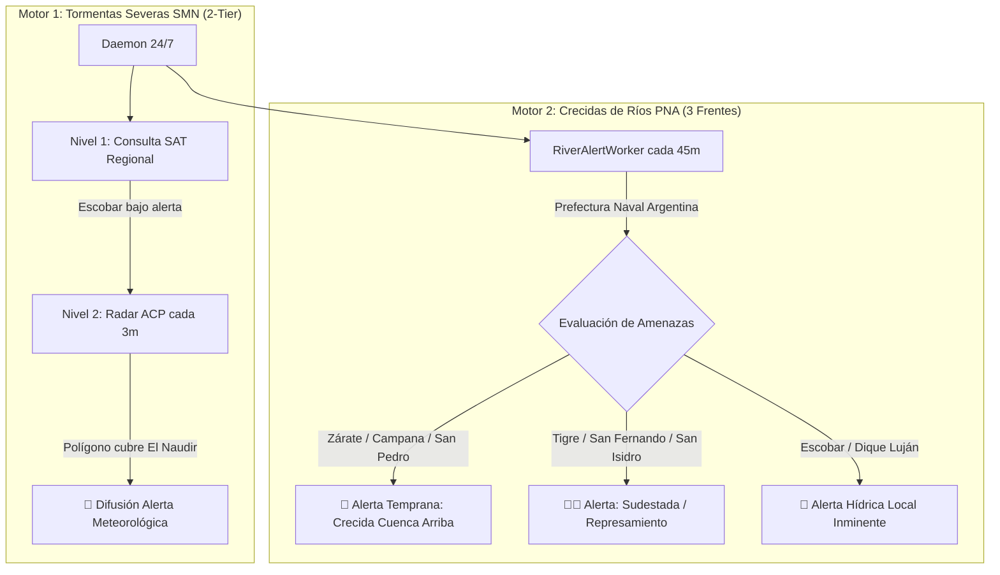

# NaudirEarlyAlert 🌩️🌊🤖

> Daemon autónomo 24/7 y Bot de Telegram para detección temprana y alerta inmediata de **tormentas severas (SMN)** y **crecidas e inundaciones de ríos (Prefectura Naval Argentina)** para el **Barrio El Naudir – Aguas Privadas** (Belén de Escobar, Buenos Aires).

---

## 📍 Coordenadas y Zona de Monitoreo

- **Ubicación:** Barrio El Naudir – Aguas Privadas (Escobar, Bs. As.)
- **Latitud:** `-34.3100`
- **Longitud:** `-58.7391`
- **Zona Administrativa SAT:** `"Escobar"`
- **SMN Location ID:** `4816` (Parque El Cazador / Escobar)
- **Cuenca Hídrica:** Delta del Río Paraná / Río Luján / Canal Villanueva

---

## ⚙️ Arquitectura del Sistema

El daemon ejecuta de forma concurrente dos motores de monitoreo proactivo:



### 1. Monitoreo Meteorológico SMN (2-Tier State Machine)
- **Nivel 1 (SAT):** Monitorea alertas del SMN para el partido de Escobar. Si no hay alertas activas, el radar se mantiene dormido.
- **Nivel 2 (ACP):** Cuando hay alerta activa, consulta avisos a muy corto plazo cada 3 minutos, evalúa geometría espacial con **Shapely** (`Polygon.contains(Point)`) y alerta solo si la celda de tormenta cubre El Naudir.

### 2. Monitoreo Hidrométrico PNA (Detección de Fenómenos Extraordinarios)
El bot opera en **Modo Ultra Silencioso**: no emite alertas por variaciones menores ni niveles de alerta ordinarios (donde solo se tapan muelles o humedales). Está calibrado con las cotas reales y el comportamiento empírico del Barrio El Naudir:

- **Calibración Empírica (Benchmark Histórico Dic 2023):** En el temporal del 18-19 de diciembre de 2023 (la mayor sudestada en 13 años, donde Tigre alcanzó `3.70 m` y Escobar `~3.30 m`), las calles de El Naudir permanecieron secas sin anegamientos. Los umbrales de alerta están calibrados estrictamente por encima de este benchmark para evitar falsas alarmas.
- **Escalas Oficiales PNA (Sin conversiones ficticias a IGN):** Las alturas se informan exactamente según la escala de cada puerto de Prefectura Naval Argentina (PNA), dado que cada estación cuenta con un cero hidrométrico local propio.
- **Comunicación 100% Informativa:** Notificaciones objetivas que indican estación, nivel hidrométrico PNA, variación, situación de cuenca, tiempo estimado de viaje (~6 a 12 hs para cuenca alta) y estaciones de referencia en vivo (sin especulaciones ni directivas paternalistas como "cortar luz" o "subir muebles").

#### Niveles y Frentes de Alerta:
- **Zona Local (Escobar / Dique Luján):**
  - `ALERTA_LOCAL` (`Escobar >= 3.80 m`, `Dique Luján >= 3.00 m`): Nivel de advertencia local calibrado para El Naudir (supera la marca del temporal de 2023, alerta por saturación de desagües pluviales).
  - `EMERGENCIA_EXTREMA` (`Escobar >= 4.10 m`, `Dique Luján >= 3.30 m`): Crecida local crítica alcanzando cotas de calzadas bajas y accesos en el barrio.
- **Cuenca Arriba (Río Paraná - Zárate / Campana / San Pedro) — Modelo Combinado de Confluencia:**
  - **Filtro Inteligente de Desagüe:** Las crecidas de río arriba (`Zárate >= 2.50 m`) **solo alertan si el río aguas abajo está cargado o no desagota** (`Tigre >= 2.50 m CRECE` o `>= 3.00 m`, o `Escobar >= 2.50 m`). Si el Río de la Plata drena libremente, el sistema permanece en silencio para evitar falsas alarmas.
  - `AVISO_PREVENTIVO` (`Zárate >= 2.50 m` + Represamiento aguas abajo): Aviso con **6 a 12 horas de anticipación** por confluencia hídrica.
  - `CRECIDA_MASIVA` (`Zárate >= 3.10 m` + Represamiento aguas abajo): Crecida de gran magnitud en cuenca alta con salida restringida al estuario.
  - `EMERGENCIA_EXTREMA` (`Zárate >= 3.80 m`): **Trigger de volumen colosal por seguridad** (supera por casi medio metro el récord histórico de 3,32 m). Se dispara de forma unilateral ("no hay delta que aguante"), sin importar el estado del estuario.
  - `San Pedro / Baradero` (`>= 3.60 m` / `>= 2.80 m`): Seguimiento preventivo con **24 a 48 horas de antelación** si la cuenca inferior está cargada.
- **Sudestada / Cuenca Abajo (Tigre / San Fernando):**
  - `ALERTA_LOCAL` (`Tigre >= 3.80 m`): Marea superando el récord de dic-2023 (`3.70 m`) con taponamiento y represamiento directo de desagües.
  - `EMERGENCIA_EXTREMA` (`Tigre >= 4.05 m`): Sudestada de magnitud histórica excepcional.

---

## 📱 Comandos del Bot en Telegram

| Comando | Descripción |
| :--- | :--- |
| `/start` | Suscribe al usuario para recibir alertas de tormentas y crecidas en El Naudir. |
| `/stop` | Cancela la suscripción y elimina al usuario de la lista de difusión. |
| `/estado` | Muestra el estado del daemon, alerta SAT, modo de radar, altura actual de ríos y suscriptores. |
| `/rio` | Muestra el tablero completo en tiempo real con alturas, tendencias y variaciones de los ríos (Prefectura Naval). |
| `/descartes` | Lista tormentas vigentes en la región descartadas por estar fuera de cobertura (con distancia en km). |
| `/prueba` | Envía una alerta de tormenta simulada **únicamente a tu chat**. |
| `/testrio` | Envía una alerta hídrica simulada a tu chat (`/testrio`, `/testrio cuenca`, `/testrio cuenca masiva`, `/testrio sudestada`). |
| `/help` | Muestra la ayuda y lista de comandos disponibles. |

### Formato de Alerta Difundida
```html
⚠️ ALERTA METEOROLÓGICA (ACP) ⚠️

⚡ Fenómeno: TORMENTAS FUERTES CON LLUVIAS INTENSAS Y OCASIONAL CAIDA DE GRANIZO
🟠 Severidad: Naranja (Tormentas fuertes / severas)
⏱️ Emisión: 07:38 hs
⏳ Vigencia: Hasta las 09:38 hs (2 horas de validez)

Zonas bajo aviso:
• BUENOS AIRES: Escobar - Campana - Pilar - Tigre.

📍 Tormenta severa detectada sobre nuestras coordenadas (El Naudir).

📡 Ver radar en vivo (animación oficial)
🛰️ Ver satélite GOES-16 (Topes nubosos)
🌐 Ver Avisos a Muy Corto Plazo en SMN
```

---

## 🌎 ¿Cómo adaptarlo para cualquier otra localidad o barrio en Argentina?

Este sistema es **100% modular y configurable**. No requiere modificar el código Python para funcionar en cualquier otro punto del país (barrios cerrados, campos agrícolas, clubes, municipios o ciudades).

Solo necesitas configurar 3 variables en tu archivo `.env`:

### 1. Obtener Coordenadas GPS (Latitud y Longitud)
1. Abrí [Google Maps](https://maps.google.com).
2. Hacé clic derecho sobre la ubicación exacta de tu barrio o casa.
3. Copiá el primer número (Latitud) y el segundo (Longitud).
   * *Ejemplo:* `-34.3100, -58.7391`

### 2. Identificar la Zona Administrativa del SMN
Es el nombre del **Partido o Departamento** oficial según las alertas del SMN:
* *Ejemplos comunes:* `Escobar`, `Pilar`, `Tigre`, `San Isidro`, `La Plata`, `Rosario`, `Córdoba`, `Mar del Plata`.
* *Auto-Resolución de ID:* El cliente consulta automáticamente la API de georeferencia del SMN (`georef/location/coord`) con tus coordenadas para obtener el ID de estación oficial más cercana (ej: `4816`).

### 3. Configurar tu `.env`

Editá tu `.env` con los datos de tu nueva localidad:

```ini
# Nombre que aparecerá en los mensajes de Telegram
LOCATION_NAME=Barrio Los Alisos

# Coordenadas exactas del polígono/casa
ALERT_LAT=-34.4215
ALERT_LON=-58.6480

# Partido / Departamento oficial
ALERT_ZONE=Tigre
```

---

## 🚀 Despliegue y Mantenimiento en Servidor (GCP / Ubuntu)

### 1. Requisitos Previos
* Python 3.10+
* Virtualenv (`python3-venv`)
* Token de Telegram obtenido en `@BotFather`
* Token opcional de Scrape.do para auto-renovación de JWT (1.000 requests/mes gratis)

### 2. Configurar Variables de Entorno (`.env`)
Creá tu archivo `.env` a partir de la plantilla y completá tus variables:
```bash
cp .env.example .env
nano .env
```
*(Completá tu `TELEGRAM_BOT_TOKEN`, coordenadas y zona según la sección anterior).*

### 3. Servicio Autónomo 24/7 (`systemd`)
El bot se administra mediante un servicio de usuario de `systemd` que sobrevive a cierres de sesión SSH y reinicios de la máquina virtual gracias a `linger`:

```bash
# Habilitar persistencia de usuario (se ejecuta una sola vez como root/ubuntu)
sudo loginctl enable-linger $USER

# Iniciar o reiniciar el servicio
systemctl --user restart smn-bot

# Ver logs en vivo
journalctl --user -u smn-bot -f

# Ver estado
systemctl --user status smn-bot
```

### 4. Actualización Rápida de Versión
Para aplicar actualizaciones subidas al repositorio:
```bash
cd ~/NaudirEarlyAlert && git pull && systemctl --user restart smn-bot
```

---

## 🧪 Pruebas Automatizadas

El proyecto cuenta con una suite completa de tests unitarios:
- Verificación geométrica de polígonos GeoJSON / coordenadas SMN (`shapely`).
- Deduplicación de avisos y persistencia en SQLite.
- Cálculo de duración y formato de mensajes HTML.
- Filtrado y descarte de tormentas lejanas.

Ejecutar tests:
```bash
python -m unittest discover tests/
```

---

## 📄 Licencia

Desarrollado para la comunidad de **El Naudir – Aguas Privadas**.
Distribuido bajo licencia MIT.
